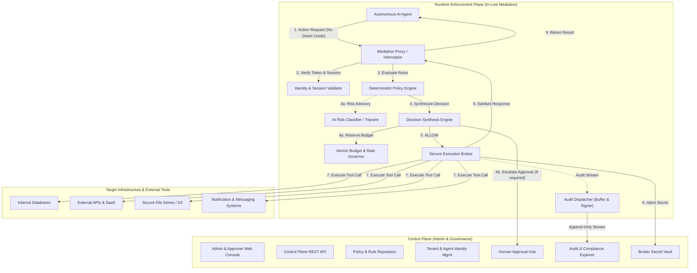
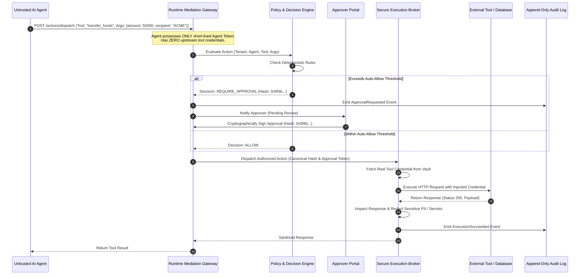
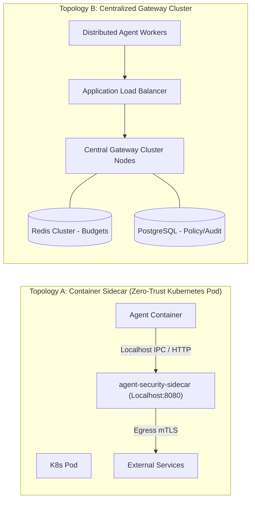

# System Architecture & Deployment Specification
## Autonomous AI Agent Security & Runtime Governance Platform

**Document Version:** 1.0.0  
**Phase:** Phase 0 (Scope & Security Architecture)  
**Status:** Approved Architecture Baseline  

---

## 1. Architectural Overview: Control Plane vs. Runtime Enforcement Plane

The platform cleanly bifurcates into two distinct architectural planes with separate operational characteristics, security boundaries, and scaling models:

### 1.1. Control Plane
- **Purpose**: Manage system configuration, administrative policies, tenant hierarchies, agent identities, human-in-the-loop approvals, and compliance analytics.
- **Components**:
  - **Policy & Rule Repository**: Version-controlled declarative policy store (GitOps-backed or relational DB) with cryptographic signing of policy manifests.
  - **Tenant & Agent Identity Management**: Issues short-lived agent session tokens, mTLS certificates, and manages agent registration.
  - **Approval Hub**: Real-time WebSocket/REST dashboard for human approvers to review, inspect, and approve or reject `REQUIRE_APPROVAL` requests.
  - **Audit Analytics Engine**: Searchable indexing and storage layer for audit events, supporting compliance exports and anomaly analytics.
  - **Broker Secret Vault**: Enterprise secret manager (e.g., HashiCorp Vault, AWS Secrets Manager) storing actual tool/API credentials, isolated from agents.

### 1.2. Runtime Enforcement Plane
- **Purpose**: Low-latency, high-throughput, in-line mediation of every single action request generated by an agent.
- **Components**:
  - **Mediation Proxy / Interceptor**: Protocol-specific gateway (REST, JSON-RPC, Model Context Protocol - MCP) that terminates agent connections.
  - **Identity & Session Validator**: Checks agent signature, session validity, and verifies the kill switch state.
  - **Deterministic Policy Engine**: High-speed in-memory evaluation of ABAC/RBAC rules, parameter constraints, regex guards, and denial lists.
  - **AI Risk Classifier (Advisor)**: Asynchronous or sidecar LLM guardrail analyzing semantic drift, anomalous tool sequencing, and prompt injection indicators. Can escalate to `REQUIRE_APPROVAL` or `BLOCK`, but **never** override a deterministic denial.
  - **Decision Synthesis Engine**: Combines deterministic rules and risk advisory into the final platform decision (`ALLOW`, `BLOCK`, `REQUIRE_APPROVAL`, `SUSPEND`).
  - **Atomic Budget Governor**: Distributed atomic counter (backed by Redis or in-memory transactional locks) preventing race conditions on budgets and rate limits.
  - **Secure Execution Broker**: The sole component authorized to access external tools. Injects credentials, invokes the upstream system, validates response schemas, and redacts sensitive data.
  - **Audit Dispatcher**: Buffers and emits signed, tamper-evident audit records without blocking the hot execution path.

---

## 2. In-Line Mediation vs. Passive Monitoring

A fundamental flaw of legacy governance tools is "passive monitoring" (asynchronous log ingestion), which alerts security teams *after* an agent has already executed an unauthorized wire transfer, dropped a database table, or exfiltrated private customer records.

The platform implements **True In-Line Mediation**:

### Key Principles of In-Line Mediation:
1. **Zero Upstream Credentials Exposed to Agent**: Agents are only issued ephemeral tokens valid against the Mediation Gateway. Raw database passwords, API bearer tokens, and private keys reside exclusively inside the Secure Execution Broker.
2. **Synchronous Interception**: No action reaches the target resource without passing the Gateway and receiving an explicit `ALLOW` decision.
3. **Response Sanitization & Guardrails**: Both outgoing arguments and incoming tool outputs are filtered to prevent secondary injection and data exfiltration.

---

## 3. End-to-End Request Pipeline

1. **Ingress & Authentication**:
   - Agent presents `Authorization: Bearer <agent_session_token>` and an action request payload.
   - Gateway verifies token signature, tenant ID, and checks if session or agent is marked `SUSPENDED`.
2. **Canonical Hashing**:
   - The Gateway computes the canonical cryptographic hash ($SHA-256$) of `{tenant_id, project_id, agent_id, session_id, tool_name, arguments_canonical_json}`.
   - This hash guarantees argument immutability across the evaluation and execution lifecycle.
3. **Policy Evaluation**:
   - Rule matching: Check tool whitelist/denylist for agent role.
   - Parameter constraints: Validate data types, allowed values, bounds, regex patterns.
   - Contextual limits: Query Atomic Budget Governor for remaining hourly/daily spend and rate limits.
4. **AI Risk Assessment (Optional/Conditional)**:
   - For sensitive tools, run heuristic and classifier tripwires.
   - Risk escalation: If risk score exceeds warning threshold, tighten `ALLOW` $\to$ `REQUIRE_APPROVAL` or `BLOCK`.
5. **Decision Synthesis**:
   - Compute final decision: `ALLOW`, `BLOCK`, `REQUIRE_APPROVAL`, or `SUSPEND`.
6. **Approval Workflow (Branch)**:
   - If `REQUIRE_APPROVAL`: Freeze execution, issue approval record with unique approval ticket ID tied to the canonical hash. Block until human approves or timeout expires (default 15 minutes).
7. **Execution Broker Dispatch**:
   - If `ALLOW` (or approved): Broker locks the budget, fetches credentials from Vault, dispatches call to upstream endpoint.
8. **Egress Sanitization**:
   - Intercept tool response; run PII detector and secret redaction regexes before returning to agent.
9. **Tamper-Evident Audit Emission**:
   - Emit structured event to audit pipeline with execution duration, canonical hashes, and status.

---

## 4. Deployment Topologies

### 4.1. Topology A: Kubernetes Sidecar (Zero-Trust Local Proxy)
- **Use Case**: Agents executing code or running in isolated container workloads.
- **Mechanism**: The governance engine runs as a sidecar container in the same pod. Network policies block all direct egress from the agent container except to `127.0.0.1:8080` (the sidecar).
- **Advantages**: Ultra-low latency ($< 2\text{ ms}$ policy evaluation), zero cross-pod network hops for policy checks, hard physical network egress containment.

### 4.2. Topology B: Centralized Cloud Gateway Cluster
- **Use Case**: Multi-tenant SaaS platforms, shared corporate agents, or serverless agent invocations.
- **Mechanism**: Agents communicate with a horizontally scalable gateway cluster behind an Application Load Balancer with mTLS.
- **Advantages**: Centralized administration, unified audit pipeline, simplified enterprise compliance and auditing.

---

## 5. Security & Isolation Invariants

1. **Strict Tenant Sandboxing**: Every database table, cache key, and message queue topic is partitioned by `tenant_id`. No query or state access may occur without an explicit `tenant_id` predicate.
2. **Immutable Approval Binding**: Approvals sign the exact $SHA-256$ hash of canonical arguments. Any change in arguments invalidates the approval token automatically.
3. **Atomic Budget Reservation**: Budget deductions are performed atomically via two-phase reservation (Reserve $\to$ Execute $\to$ Commit/Rollback) to eliminate concurrency race conditions.
4. **Audit Trail Integrity**: Audit events are cryptographically hashed and linked in a merkle/hash chain per session, making retroactive log alteration immediately detectable.
