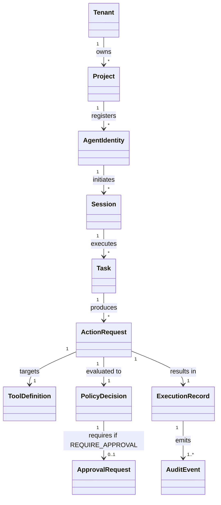
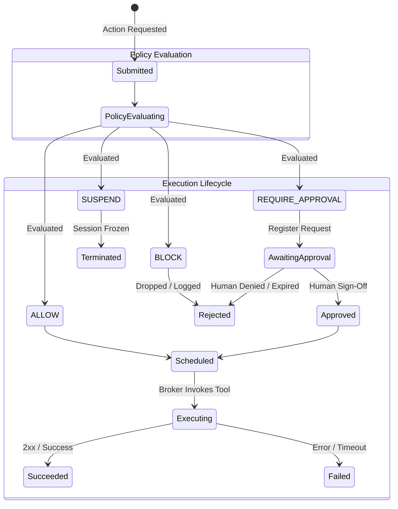

# Product Requirements Document (PRD)
## Autonomous AI Agent Security & Runtime Governance Platform

**Document Version:** 1.0.0  
**Phase:** Phase 0 (Scope & Security Architecture)  
**Status:** Approved Architecture Baseline  

---

## 1. Executive Summary & Vision

The **Autonomous AI Agent Security & Runtime Governance Platform** provides deterministic, policy-driven runtime mediation for autonomous AI agents interacting with enterprise tools, APIs, databases, files, and external systems.

Modern AI agents generate non-deterministic execution paths, invoke tools dynamically, and consume untrusted external inputs. Traditional API gateways and perimeter firewalls are insufficient because they lack semantic awareness of agent context, session lineage, multi-step goal drift, and prompt-driven manipulation. 

This platform sits in the execution path as an **in-line mediation broker and runtime enforcement guardrail**, ensuring that:
1. No agent can execute an external side-effect without verified identity, scoped authorization, and real-time policy evaluation.
2. Every action produces a deterministic verdict: `ALLOW`, `BLOCK`, `REQUIRE_APPROVAL`, or `SUSPEND`.
3. High-risk operations require cryptographic, human-in-the-loop (HITL) approval that cannot be replayed or altered.
4. AI-generated risk evaluations can tighten or escalate restrictions, but can **never** override a deterministic denial.
5. All activities are recorded in a tamper-evident audit log with session and task lineage.

---

## 2. Platform Decisions & Governance Semantics

The platform renders one of four explicit runtime decisions for every action request:

| Decision | Semantic Meaning | Runtime Behavior |
| :--- | :--- | :--- |
| **`ALLOW`** | The action satisfies all deterministic policies, budget constraints, context guardrails, and risk thresholds. | The execution broker executes the action against the target resource using scoped broker-managed credentials. |
| **`BLOCK`** | The action violates a hard constraint, safety policy, boundary limit, or denial rule. | The execution broker halts execution immediately, returns a structured error to the agent, and emits a high-severity security audit event. |
| **`REQUIRE_APPROVAL`** | The action is permitted conditionally subject to authorized human confirmation (e.g., destructive actions, spend limits, PII access). | A tamper-resistant approval request is registered. Execution halts until an authorized approver reviews and signs the exact action payload. |
| **`SUSPEND`** | Severe anomaly detected (e.g., repeated policy violations, suspected takeover, kill switch trigger, prompt injection tripwire). | The agent's active session and execution token are invalidated. All pending actions are frozen, and the incident response team is alerted. |

---

## 3. Product Scope: MVP vs. Post-MVP

### 3.1. MVP Scope (Current Target)

1. **In-Line Tool Mediation Broker**:
   - Protocol support for REST/HTTP tool invocations and standard JSON-RPC / MCP (Model Context Protocol) tool interfaces.
   - Credential isolation: Agents never touch raw API keys or database connection strings; the broker injects credentials upon `ALLOW`.
2. **Deterministic-First Policy Engine**:
   - Role-Based and Attribute-Based Access Control (RBAC/ABAC) evaluating tenant, project, agent identity, session, tool, and argument schemas.
   - Parameter-level boundary validation (regex, enum, range checks, path traversal blocking).
   - Rate limiting and token/dollar budget counters per session and tenant.
3. **Cryptographic Human-in-the-Loop (HITL) Approval Workflow**:
   - Explicit `REQUIRE_APPROVAL` lifecycle.
   - Cryptographic canonical payload hashing ($SHA-256$) to prevent approval replay and post-approval argument mutation.
   - Configurable approval timeouts and auto-expiration.
4. **Agent Session & State Machine Management**:
   - Strict decoupling of Policy Decision from Execution Lifecycle states.
   - Enforcement of session kill switch and agent suspension.
5. **Tamper-Evident Structured Audit Logging**:
   - Structured JSON audit records with tenant isolation, session ID, task ID, action hash, and cryptographic signature chain.
   - Zero credential logging: automatic redaction of bearer tokens, passwords, and sensitive headers.
6. **Fail-Secure Defaults**:
   - Standard fail-closed enforcement when policy engines, identity services, or databases are unreachable.
7. **Typed Core Contracts & Test Matrix**:
   - Complete schema contracts and automated invariant test suite.

### 3.2. Post-MVP Scope

1. **Adaptive & ML-Based Risk Classifiers**:
   - Dynamic semantic drift detection across multi-turn agent execution trees.
   - LLM-based intent-drift classifiers running asynchronously to flag suspicious goal divergences (always subordinate to deterministic rules).
2. **Database & SQL Query Deep Inspection**:
   - AST parsing of SQL queries for dynamic data masking, table-level ACLs, and row-level tenant security filtering.
3. **Container & Filesystem Sandbox Virtualization**:
   - Ephemeral micro-VM (e.g., Firecracker / gVisor) sandboxes for code-interpreter agents with eBPF-based syscall filtering.
4. **Hardware Security Module (HSM) Integration**:
   - Asymmetric hardware key signing for enterprise approval attestations and immutable audit log notarization (e.g., AWS KMS / RFC 3161 timestamping).
5. **Decentralized Multi-Region Policy Sync**:
   - Globally distributed policy evaluation with Raft/CRDT state synchronization for multi-region active-active deployments.

---

## 4. Core Conceptual Model & Domain Definitions

### 4.1. Entity Definitions

1. **Tenant**: The top-level isolation boundary representing an enterprise organization or customer. All policies, agents, logs, and credentials belong strictly to a single tenant. Cross-tenant sharing is strictly prohibited.
2. **Project**: A logical sub-environment within a tenant (e.g., `fraud-detection-prod`, `customer-support-dev`) containing dedicated policies, budgets, and tool registrations.
3. **Agent Identity**: The authenticated entity representing an AI agent instance, assigned a unique cryptographic identifier, role, owner, and authorization profile.
4. **Session**: A continuous conversational or operational interaction bounded by time and context, containing an ephemeral authentication token and accumulated budget ledger.
5. **Task**: A distinct unit of work or sub-goal within a session (e.g., "Summarize customer records and send alert").
6. **Tool**: A registered capability exposed to agents (e.g., `send_email`, `execute_sql`, `read_file`, `invoke_payment_gateway`), defining strict input/output JSON schemas and risk classifications.
7. **Action Request**: A concrete invocation initiated by an agent specifying `action_id`, `tool_name`, `arguments`, `session_id`, `task_id`, and `timestamp`.
8. **Policy**: A deterministic declarative rule set defining allowed actions, argument constraints, required approval thresholds, and rate limits.
9. **Decision**: The governance evaluation outcome (`ALLOW`, `BLOCK`, `REQUIRE_APPROVAL`, `SUSPEND`).
10. **Approval Request**: An immutable, cryptographically bound artifact created when an action yields `REQUIRE_APPROVAL`, containing the exact hash of the action request, approver assignment, and expiration.
11. **Execution**: The runtime lifecycle state of the physical action handled by the execution broker.
12. **Audit Event**: An append-only, tamper-evident, structured record capturing the who, what, when, why, and outcome of an action.

---

## 5. Enforcement Boundaries: Supported vs. Unsupported

To ensure zero ambiguity and avoid false security promises, the platform defines explicit boundaries:

### 5.1. Supported Enforcement Boundaries
- **Tool Invocations (API / Webhook / RPC / MCP)**: Full in-line mediation; parameter validation; credential brokering; response sanitization.
- **Data Access & Storage Gateways**: Interception of queries and payload sizes; read-only enforcement; row/tenant ID constraint validation.
- **Agent Identity & Session Control**: Token validation, session lifetime expiry, instant revocation via session kill switch.
- **Budget & Rate Limiting**: Atomic concurrency locks preventing concurrent action bursts beyond assigned limits.

### 5.2. Explicitly Unsupported Boundaries
- **Direct Host Memory & Raw Socket Access**: If an agent process runs with unconfined root host access and unrestricted network sockets bypassing the proxy, the platform cannot guarantee mediation.
- **Mathematical Impossibility of 100% Prompt Injection Immunity**: Prompt injection cannot be completely prevented at the language level. The platform enforces defense-in-depth: structural containment, tool least-privilege, and parameter verification so that even a compromised prompt cannot invoke unauthorized actions.
- **Reversal of Completed Physical Side Effects**: A kill switch or suspension stops *future* actions immediately; it **cannot** un-send a dispatched wire transfer or undo an external webhook already acknowledged by a third-party server.
- **Proprietary LLM Internal Weights / Hidden Activation States**: The platform mediates inputs and outputs; it does not inspect proprietary vendor LLM internal activation vectors or hidden states.

---

## 6. Decoupling Policy Decision from Execution Lifecycle

A common architectural vulnerability in naive agent frameworks is conflating the policy evaluation outcome with the execution status. In this platform, **Policy Decision** and **Execution Lifecycle State** are strictly orthogonal and tracked by independent state machines:

### 6.1. States Matrix

| Dimension | Possible States | Responsible Component |
| :--- | :--- | :--- |
| **Policy Decision** | `EVALUATING`, `ALLOW`, `BLOCK`, `REQUIRE_APPROVAL`, `SUSPEND` | Policy Engine / Decision Engine |
| **Execution State** | `SUBMITTED`, `AWAITING_APPROVAL`, `APPROVED`, `REJECTED`, `SCHEDULED`, `EXECUTING`, `SUCCEEDED`, `FAILED`, `CANCELLED` | Execution Broker |

---

## 7. Outage & Failure Behavior (Fail-Secure Matrix)

The platform adopts **Fail-Secure (Fail-Closed)** as its primary security posture. Under no circumstances may an infrastructure component failure result in an unauthenticated or unauthorized action being permitted.

| Component Outage | Failure Behavior | Default Verdict | Operational Impact & Rationale |
| :--- | :--- | :--- | :--- |
| **Policy Engine Outage** | Fail-Closed | `BLOCK` | If policy rules cannot be evaluated, no action can be permitted. Emits critical telemetry. |
| **Identity Service Outage** | Fail-Closed | `BLOCK` | If agent identity or tenant credentials cannot be verified, execution is rejected. |
| **Audit Log Storage Outage** | Fail-Closed (Configurable buffer with circuit breaker) | `BLOCK` (when buffer exceeds high-water mark) | Actions must not execute without an audit trail. An in-memory/spool buffer absorbs transient micro-spikes (max 5s); if full, all actions are `BLOCK`ed. |
| **Primary Database Outage** | Fail-Closed | `BLOCK` | Session states, budgets, and locks cannot be guaranteed. Operations halt safely. |
| **AI Risk Classifier Outage** | Fail-Open to Deterministic Baseline ONLY | Fallback to Deterministic Policy | If an asynchronous or secondary AI classifier is unavailable, deterministic rules still evaluate. If deterministic evaluation yields `ALLOW`, it proceeds; if deterministic yields `REQUIRE_APPROVAL` or `BLOCK`, that is strictly upheld. AI classifier **cannot** turn a `BLOCK` into an `ALLOW`. |

---

## 8. Service Level & Operational Targets

> **IMPORTANT:** The following metrics are architectural design targets for the MVP. They are explicitly defined as **targets until benchmarked and verified under load tests**.

| Metric Category | Target Value | Verification Method |
| :--- | :--- | :--- |
| **P95 Decision Latency (Deterministic)** | $< 15\text{ ms}$ | In-memory policy cache, local schema validation benchmarks. |
| **P99 Decision Latency (Deterministic)** | $< 35\text{ ms}$ | High-concurrency synthetic load tests. |
| **P95 Execution Broker Overhead** | $< 25\text{ ms}$ (exclusive of external tool response) | Benchmark harness measuring proxy ingress-to-egress delta. |
| **Throughput (Single Node)** | $\ge 1,000\text{ actions/second}$ | Multi-threaded async benchmark runner. |
| **Audit Log Retention (MVP)** | 90 days active queryable, 1 year cold storage | Partitioned storage policy and archiving cron. |
| **Platform Availability Target** | 99.9% uptime (excluding scheduled maintenance) | Redundant cluster deployment with health-check probes. |
