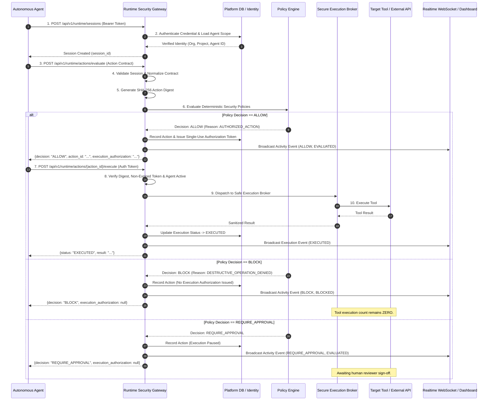

# Runtime Flow & Mediation Lifecycle

## 1. High-Level Flow Diagram

---

## 2. Step-by-Step Lifecycle

### Step 1: Identity & Authentication
- Agents provide a secret bearer credential.
- Gateway hashes the credential and matches it against database records.
- Verifies `is_active`, `expires_at`, and `agent.status != 'revoked'`.
- Derives `organization_id` and `project_id` strictly from the credential.

### Step 2: Session Establishment
- Binds an ephemeral `session_id` to the agent identity.
- Sets expiration and tracking metadata.

### Step 3: Action Normalization & Cryptographic Digest
- Validates the incoming action contract (`tool`, `operation`, `resource`, `arguments`, `purpose`).
- Canonicalizes arguments into deterministic JSON representation.
- Calculates `action_digest = sha256(canonical_payload)`.

### Step 4: Deterministic Policy Evaluation
- **Agent Suspension Check**: If agent status is `suspended`, verdict is `SUSPEND` / `BLOCK`.
- **Resource Scope Check**: Restricted prefixes (`secrets/`, `credentials/`) yield `BLOCK`.
- **Destructive Mutation Check**: Destructive operations (`delete`, `drop`) yield `BLOCK`.
- **Production Mutation Check**: State changes in production yield `REQUIRE_APPROVAL`.
- **Safe Permitted Operations**: Low-risk operations on allowed resources yield `ALLOW`.

### Step 5: Execution Authorization & Pre-Execution Re-verification
- For `ALLOW` decisions, creates an ephemeral, single-use `execution_authorization` token.
- When `/execute` is called, the Gateway re-verifies:
  1. Agent is still active (not suspended during the window).
  2. Token is unexpired and unconsumed.
  3. Action digest matches the evaluated action.
  4. Session remains active.

### Step 6: Tool Execution & Telemetry Emission
- Safe tool executes inside the isolated broker.
- Sanitized results are returned to the agent.
- Runtime activity is persisted in PostgreSQL and broadcast live via WebSocket to the Next.js Dashboard.
